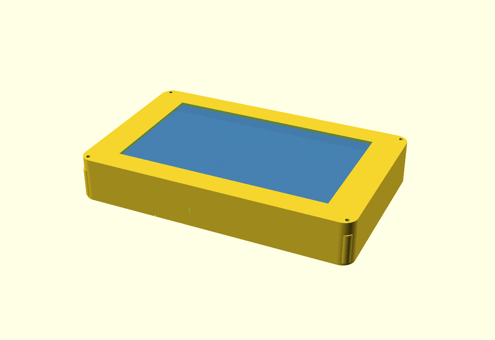
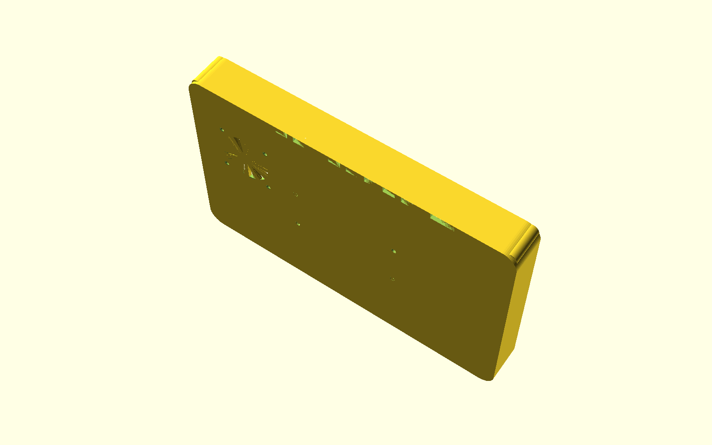

# dash_housing

A nice housing for the **Waveshare ESP32-S3-Touch-LCD-7** running
[`esp32_ms_dash`](https://github.com/Carputer-project/esp32_ms_dash).

A clean 3D printed dash enclosure that turns a bare 7" ESP32-S3 display into something you can
actually mount in a car. Fits the Waveshare ESP32-S3-Touch-LCD-7, holds the screen, and gives the
board somewhere to live.

## Features

- **Snap-free screw-together build** — bezel and tub bolt together at four corners, no adhesives
- **Properly drafted cavity** — 1° draft inside so it prints support-free and the core pulls clean
- **Rounded outer corners (R10)** and a flush bezel/tub mate line
- **Built-in 40mm fan** — fan well, mounting screws and guard grille all part of the tub, so the
  airflow path is designed in rather than hacked
- **Real finned exhaust grille** on the bottom edge — proper cooling air exit, not an open slot
- **Dedicated cable exit** — a small neat hole for the harness
- **Screen mount plate** — proper mounting frame behind the LCD instead of the screen floating
- **iobox3 PCB bay** — mounts an 87.6 × 76.7mm auxiliary board inside, on standoffs, with its own
  M2 screw bosses
- **Rear pole bracket** — 4 × M4 pattern for mounting to a dash pole or custom bracket
- **No supports, no bridging tricks** — prints flat and straight off the bed

## Parts

| Part | Qty |
|---|---|
| Front bezel | 1 |
| Rear tub | 1 |
| Side strip | **2** |
| Screen mount plate | 1 |
| Bracket | 1 |

Five parts, one of them printed twice.

## Print settings

3–4 perimeters, 40% infill, no supports.

